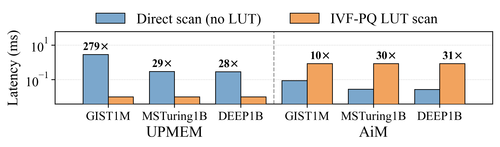
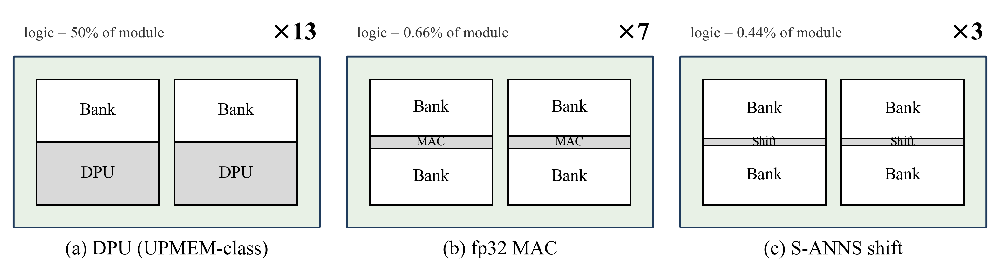
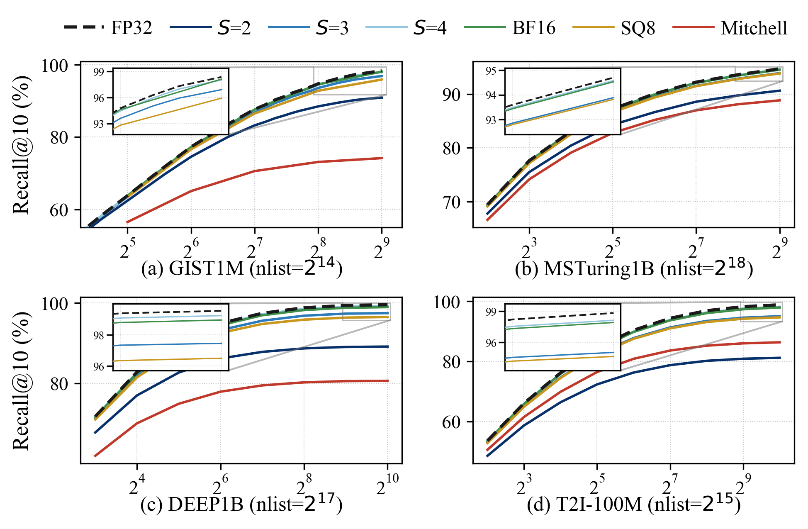
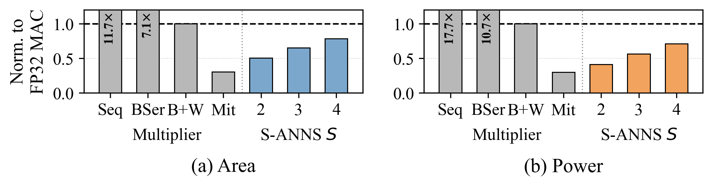
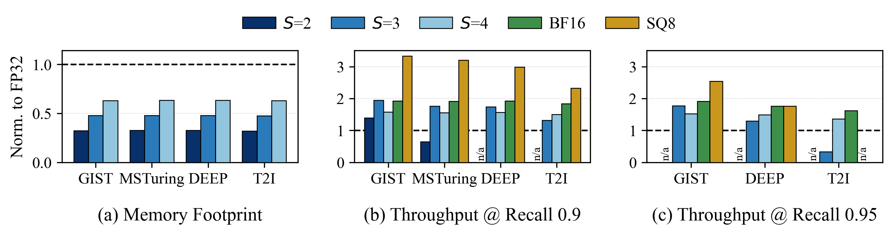

# S-ANNS: Energy-Efficient Approximate Nearest Neighbor Search via Shift-Based PIM Architecture

[](https://ieeexplore.ieee.org/document/11738663/)
[](https://doi.org/10.1109/LCA.2026.3743912)

This repository contains the official implementation and artifact of **S-ANNS** (Shift-ANNS),
published in **IEEE Computer Architecture Letters (CAL), 2026**.

> **S-ANNS: Energy-Efficient Approximate Nearest Neighbor Search via Shift-Based PIM Architecture**<br>
> Seulki Kim<sup>1,\*</sup>, Yewon Jang<sup>2,\*</sup>, Minho Kim<sup>1</sup>, Daehoon Kim<sup>2</sup><br>
> <sup>1</sup>DGIST, <sup>2</sup>Yonsei University &nbsp; (<sup>\*</sup>Seulki Kim and Yewon Jang contributed equally to this work.)<br>
> *IEEE Computer Architecture Letters*, vol. 25, no. 2, pp. 436–439, 2026<br>
> [[IEEE Xplore]](https://ieeexplore.ieee.org/document/11738663/) [[DOI]](https://doi.org/10.1109/LCA.2026.3743912) [[Project Page]](https://caslab-yonsei.github.io/publications/cal26-skim/)

## Abstract

Approximate Nearest Neighbor Search (ANNS) underpins Retrieval-Augmented
Generation, recommendation, and vector databases but is memory-bandwidth bound
at scale, motivating Processing-in-Memory (PIM). Existing PIM architectures,
however, trade programmability for efficiency. DPU-based designs support
flexible compression, but their general-purpose cores consume DRAM capacity
critical to billion-scale corpora, while MAC-based bank-level designs stream
only scalar-quantized vectors and cannot support LUT-based compression schemes
commonly used for float32 corpora. We present S-ANNS (Shift-ANNS), a bank-level
PIM architecture that uses Power-of-Two (PoT) quantization to encode float32
vectors as compact signed-shift representations in DRAM. This representation
replaces floating-point multiplication with shift-and-add operations during
distance computation while reducing storage overhead. With S signed terms per
dimension, the shift PE reduces per-dimension area and power relative to an
FP32 MAC by 49.4% and 58.9% at S=2 and by 21.6% and 29.2% at S=4. At S=4, the
maximum recall loss is 0.7 percentage points relative to FP32. Across GIST1M,
MSTuring1B, DEEP1B, and T2I-100M at recall@10 of 0.9, S-ANNS achieves 1.4–1.9×
higher search throughput at 0.3–0.7× the footprint.

## Repository Structure

```text
S-ANNS/
├── src/
│   ├── pot/                 # reference PoT encoder/decoder (pot.py) and a small example
│   ├── ann/                 # recall experiments on FAISS IVF (FP32, PoT S=1..5, BF16, SQ8, Mitchell)
│   │   ├── 02_2_*.py        #   FP32 + PoT recall sweeps over nprobe (shared coarse quantizer)
│   │   ├── 02_3_*.py        #   Mitchell logarithmic multiplier on the same candidates
│   │   ├── 02_4_*.py        #   scalar-quantized storage (BF16 / FP16 / SQ8) vs. PoT
│   │   ├── 02_5_*.py        #   every storage/query format on identical top-2000 candidates
│   │   ├── run_*.sh         #   the exact runs behind the paper, one script per corpus
│   │   └── download_*.sh    #   dataset download helpers
│   ├── verilog/             # RTL of the PE datapaths + Yosys/OpenSTA flow (see src/verilog/README.md)
│   └── ae/                  # Scripts that reproduce the figures and tables of the paper
│       ├── common/          #   shared plotting code of Figs. 4-6 (paper_eval.py)
│       ├── fig1/            #   online-scan latency with / without the IVF-PQ LUT
│       ├── fig2/            #   memory modules needed for DEEP1B
│       ├── fig4/            #   recall@10 vs. nprobe
│       ├── fig5/            #   PE area / power per streamed dimension
│       ├── fig6/            #   memory footprint and search throughput
│       ├── table1/          #   PE datapaths at one 32-byte burst per cycle
│       └── high_recall/     #   S=5 high-recall operating points quoted in Section IV-B
├── data/
│   ├── anns/                # FP32 + PoT IVF recall sweeps of GIST1M, MSTuring1B, DEEP1B (02_2 outputs)
│   ├── recall/              # same-candidates rerank runs (02_3 / 02_4 / 02_5 outputs) per corpus
│   ├── verilog/             # Yosys/OpenSTA area, timing and power reports of the Table I PEs
│   └── motivation/          # LUT-scan latency model values of Fig. 1
├── docs/figures/            # Reference outputs of the AE scripts
├── requirements.txt
└── CITATION.cff
```

Fig. 3 (S-ANNS overview) is a design diagram and has no script.

---

## 1. Environment Setup

The recall experiments use [FAISS](https://github.com/facebookresearch/faiss) for the IVF index
and the exact/FP16 baselines. The PEs are synthesized with [Yosys](https://github.com/YosysHQ/yosys)
on the [ASAP7](https://github.com/The-OpenROAD-Project/asap7) 7 nm predictive standard-cell library and
analyzed with [OpenSTA](https://github.com/The-OpenROAD-Project/OpenSTA). The merged ASAP7 library is
included in `src/verilog/libs/`; Yosys and OpenSTA are installed separately (Section 4).

### Requirements

- Python 3.9+
- NumPy and Matplotlib for the figure and table scripts
- pandas and `faiss-cpu` for the recall experiments in `src/ann/` (see [`requirements.txt`](requirements.txt))
- For `src/verilog/` only: Yosys and OpenSTA (the reports were produced with Yosys 0.53) and,
  for the testbenches, Icarus Verilog

```bash
pip install -r requirements.txt
export SANNS_HOME=$(pwd)
```

The figures use the Times New Roman font; without it Matplotlib falls back to its default serif
font and the layout differs slightly from the reference figures.

---

## 2. Reproducing the Figures and Tables from the Included Data

All inputs the figure and table scripts read are included in `data/`, so every figure and table
can be redrawn without the datasets, the recall experiments or the synthesis flow.
Each script can be run from any directory and saves its output next to itself.

> **Expected runtime:** a few seconds per script.

**Fig. 1: Online-scan latency with and without the IVF-PQ look-up table (UPMEM, AiM)**
```bash
cd $SANNS_HOME/src/ae/fig1
python3 plot_lut_motiv.py
# Input : data/motivation/figure_values.csv
# Output: src/ae/fig1/fig1_lut_motiv.png (latencies and LUT speedups are printed)
```

**Fig. 2: 64 GB DIMMs required to store DEEP1B for each bank-level compute architecture**
```bash
cd $SANNS_HOME/src/ae/fig2
python3 plot_module_schematic.py
# Output: src/ae/fig2/fig2_module_schematic.png (module counts 13 / 7 / 3 are printed)
```

**Fig. 4: Recall@10 versus nprobe (GIST1M, MSTuring1B, DEEP1B, T2I-100M)**
```bash
cd $SANNS_HOME/src/ae/fig4
python3 plot_recall.py
# Input : data/anns/{GIST1M,MSTuring1B,DEEP1B}_*.csv, data/recall/<corpus>/*.csv
# Output: src/ae/fig4/fig4_recall.png (saturated recall of every curve is printed)
```

**Table I: PE datapaths at one 32-byte burst per cycle with FP32 queries**
```bash
cd $SANNS_HOME/src/ae/table1
python3 get_table1.py
# Input : data/verilog/*.out
# Output: printed table and src/ae/table1/table1_pe_datapaths.csv
#         (also prints the S-ANNS area/power reduction vs. the FP32 MAC: 49.4% / 58.9% at S=2, 21.6% / 29.2% at S=4)
```

**Fig. 5: PE area and power per streamed dimension, normalized to the FP32 Booth–Wallace MAC**
```bash
cd $SANNS_HOME/src/ae/fig5
python3 plot_pe_cost.py
# Input : data/verilog/{fp32mac_*,isobw_shift_s*}.out
# Output: src/ae/fig5/fig5_pe_cost.png (the plotted ratios are printed)
```

**Fig. 6: Memory footprint and search throughput at recall@10 = 0.9 / 0.95, normalized to FP32**
```bash
cd $SANNS_HOME/src/ae/fig6
python3 plot_system.py
# Input : data/anns/*.csv, data/recall/<corpus>/*.csv
# Output: src/ae/fig6/fig6_system.png (footprints in GB and every bar value are printed)
```

**Section IV-B: high-recall operating points (S=5 vs. BF16, T2I-100M BF16 deficit)**
```bash
cd $SANNS_HOME/src/ae/high_recall
python3 high_recall.py
# Input : data/recall/high_recall/*.csv, data/recall/text2image100m/allformats_*.csv
# Output: printed table
```

Throughput in Fig. 6 is the in-bank scan stage only: with the IVF index traversed on the host, a
query streams `nprobe · N / nlist` vectors, `nlist` is fixed per corpus, and the `nprobe` that
reaches the recall target is interpolated on a log2 scale from the Fig. 4 sweeps.
The footprint includes the IVF index (FP32 centroids and 64-bit vector ids).

---

## 3. Regenerating the Recall Results (Fig. 4, Fig. 6)

The included CSVs in `data/anns/` and `data/recall/` were produced by the scripts in `src/ann/`.
One runner per corpus repeats the exact runs; each writes its CSVs to `src/ann/results/<corpus>/`,
and copying them over the files in `data/` (the runner headers list the mapping) redraws the
figures from the new results.

| Corpus | Dim / metric | Size on disk | Peak RAM | Runner | Rough runtime |
|--------|--------------|--------------|----------|--------|---------------|
| GIST1M | 960 / L2 | ~6 GB | ~16 GB | `run_gist1m.sh` | 2–4 h |
| DEEP1B | 96 / L2 | 384 GB | ~250 GB | `run_1b.sh deep1b` | 1–2 days |
| MSTuring1B | 100 / L2 | 400 GB | ~250 GB | `run_1b.sh msturing1b` | 1–2 days |
| T2I-100M | 200 / inner product | 80 GB | ~60 GB | `run_t2i100m.sh` | ~1 day |

Runtimes are rough estimates for a 28–32-core server and were not re-measured for this release.
The index caches in `data/cache/` take up to ~50 GB per billion-scale corpus.

### 3.1. Datasets

Download the corpora into `data/datasets/<corpus>/` (the default location of every script; pass
`DATA=<dir>` to a runner to use another one):

| Corpus | Source | Helper |
|--------|--------|--------|
| GIST1M | [TEXMEX corpus](http://corpus-texmex.irisa.fr/) (`ftp://ftp.irisa.fr/local/texmex/corpus/gist.tar.gz`) | extract to `data/datasets/gist1M/` |
| DEEP1B | [big-ann-benchmarks](https://big-ann-benchmarks.com/neurips21.html) (Yandex Deep1B) | `src/ann/download_deep1B.sh` |
| MSTuring1B | [big-ann-benchmarks](https://big-ann-benchmarks.com/neurips21.html) (Microsoft Turing-ANNS) | `src/ann/download_msturing1B.sh` |
| T2I-100M | [big-ann-benchmarks](https://big-ann-benchmarks.com/neurips21.html) (Yandex Text-to-Image, first 100M vectors + official 100M ground truth) | `src/ann/download_t2i_100m.sh` |

### 3.2. Running

```bash
cd $SANNS_HOME/src/ann
bash run_gist1m.sh              # GIST1M: all methods rank every probed vector
bash run_1b.sh deep1b           # DEEP1B
bash run_1b.sh msturing1b       # MSTuring1B
bash run_t2i100m.sh             # T2I-100M
# Optional: PY=<python> DATA=<dataset dir> CACHE=<cache dir> bash run_*.sh
```

On the billion-scale corpora (and T2I-100M) every method, including FP32, ranks the same 2,000
nearest candidates from an FP16-stored IVF index (`02_3` / `02_4` / `02_5`), and each script
also writes a `*_halfC` column that repeats the ranking on the top 1,000 candidates as a
truncation check. PoT codes use a 15-position exponent window (`--bmin/--bmax`: [-14, 0] for
GIST1M, [-16, -2] for the other corpora) and 5 bits per signed term.

`src/pot/pot.py` is a compact, stand-alone PoT encoder/decoder (greedy nearest power of two,
15-position window, 5-bit signed codes) that the RTL testbench mirrors; the experiment scripts
carry their own encoders, which pick the error-minimizing S-term code from the full candidate set.

```bash
cd $SANNS_HOME/src/pot
python3 example.py
```

---

## 4. Hardware Synthesis (Table I, Fig. 5)

Synthesizes the six FP32 MAC baselines, the BF16 and INT8 MACs and the S-ANNS PEs (S = 2, 3, 4)
with Yosys (ASAP7, typical corner, 0.7 V, 25 °C) and analyzes them with OpenSTA at 350 MHz.
The reports overwrite `data/verilog/*.out`. See [`src/verilog/README.md`](src/verilog/README.md)
for the design-to-report mapping.

> **Expected runtime:** about 10–20 minutes. Requires `yosys` and `sta` (OpenSTA) on `PATH`.

```bash
cd $SANNS_HOME/src/verilog
bash run_all.sh     # synthesis + STA of the eleven Table I datapaths
bash run_tb.sh      # functional checks (Icarus Verilog), incl. the 2,400-product shift-PE test
```

---

## Expected Results

Reference outputs of the AE scripts are in [`docs/figures/`](docs/figures).

| Fig. 1 | Fig. 2 |
|:---:|:---:|
|  |  |

**Fig. 4**



| Fig. 5 | Fig. 6 |
|:---:|:---:|
|  |  |

---

## Citation

If you find this work useful, please cite:

```bibtex
@article{kim2026sanns,
  author  = {Kim, Seulki and Jang, Yewon and Kim, Minho and Kim, Daehoon},
  title   = {{S-ANNS}: Energy-Efficient Approximate Nearest Neighbor Search via Shift-Based {PIM} Architecture},
  journal = {IEEE Computer Architecture Letters},
  volume  = {25},
  number  = {2},
  pages   = {436--439},
  year    = {2026},
  doi     = {10.1109/LCA.2026.3743912}
}
```

## Acknowledgements

The recall experiments use [FAISS](https://github.com/facebookresearch/faiss) and the
[big-ann-benchmarks](https://github.com/harsha-simhadri/big-ann-benchmarks) corpora.
Hardware evaluation uses [Yosys](https://github.com/YosysHQ/yosys),
[OpenSTA](https://github.com/The-OpenROAD-Project/OpenSTA) and the
[ASAP7](https://github.com/The-OpenROAD-Project/asap7) PDK (BSD 3-Clause, see `src/verilog/libs/README.md`).
